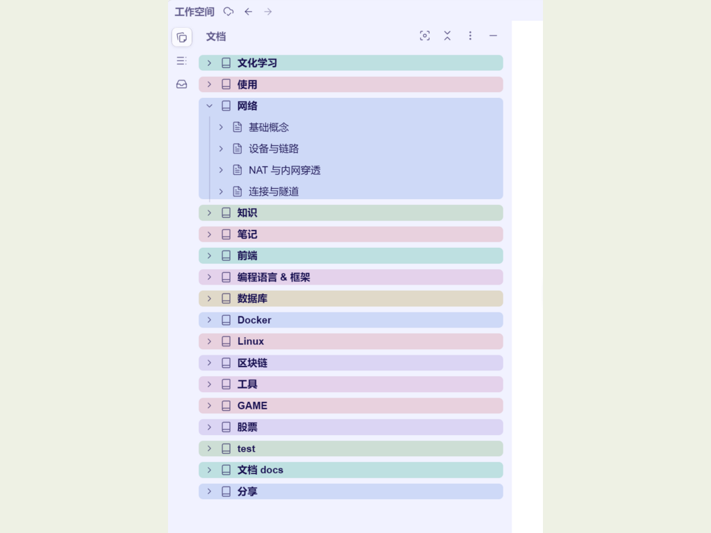

# Colorful Doc Tree（彩色文档树）

## 这是什么

给思源的**文档树**按笔记本一色染底：同一个笔记本的所有行连成一整块连续色区（块间留缝），不同笔记本不同色；也可切换为行首色条形态。文字与图标一律不动，专注于文档树本身。

装上即生效，无需配置。

## 使用

- 默认开启。设置入口：**`设置 → 集市 → 已下载 → 插件 → 彩色文档树 → 齿轮图标`**
  - 启用开关、染色浓度 / 饱和度 / 明度三个滑条（拖动实时预览）
  - 预设：**柔和** / **鲜明** 一键切换
- 命令面板（`Ctrl+P` → 输入 colorful）：
  - **切换彩色背景**
  - **彩色文档树设置**

## 边界

- 只染文档树与标签面板，**不碰编辑器内容**（性能与稳定性纪律）
- 图标颜色不变；若配合使用同样带彩色背景的主题，二选一即可（同时开会叠加染色）
- 只染文档树，不做其他面板

## 反馈

如有需要改进的地方，欢迎提交 [Issues](https://github.com/lamp3721/colorful-doc-tree/issues)。
