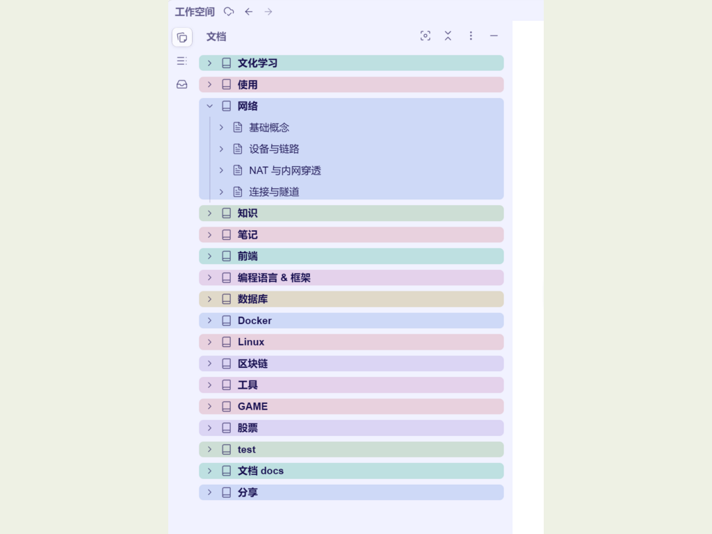

# Colorful Doc Tree（彩色文档树）

给思源的**文档树**按笔记本一色染底，不同笔记本不同色，装上即生效。

支持**桌面端、浏览器端、手机 App** 三端。

## 效果

- **整块背景**：同一笔记本的所有行连成一整块连续色区（块间留缝），不同笔记本自动分配不同颜色
- **行首色条**：可切换的极简形态——每本一条 3px 彩色竖线，背景保持干净
- 文字与图标一律不动，只染底色

## 使用

装上即生效，无需配置。想调整时：

**设置入口**：`设置 → 集市 → 已下载 → 插件 → 彩色文档树 → 齿轮图标`（手机 App 同路径）

- **基础**：启用开关、渲染形态（整块背景 / 行首色条）、🎲 重新分配颜色
- **全局色调**（默认收起）：配色基调 + 浓度/饱和度/明度三滑条 + 柔和/适中/鲜明三档预设——基色让各笔记本围绕它展开邻近色（跟主题配色走），预设一键切换质感
- **笔记本颜色**：每本可单独指定（十档快捷色 / 色板任意色 / 自动），自定义色带专属参数区可微调

**命令面板**（`Ctrl+P` 搜 colorful）：切换彩色背景 / 彩色文档树设置

## 边界

- 只染文档树，不碰编辑器内容
- 想要所有笔记本一个颜色：逐本指定即可（自动分配本身就是多色设计）

## 反馈

如有需要改进的地方，欢迎提交 [Issues](https://github.com/lamp3721/colorful-doc-tree/issues)。
